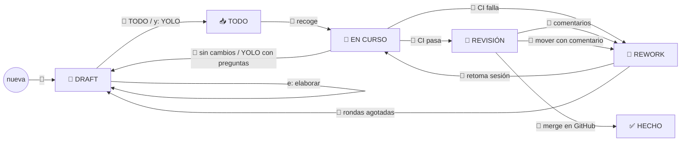

# Glosario de estados

El estado de una tarea es la columna en la que está en Vikunja. La factory lee el tablero y actúa según la columna.

Leyenda: 👤 lo haces tú · 🤖 lo hace la factory.

## Estados

### 📝 DRAFT (borrador)

La tarea está en escritura. La factory no la toca, salvo para elaborarla si lo pides.

- Puedes escribir título y descripción.
- Pulsa `e` para que Claude la amplíe: añade al contenido un análisis del repo con objetivo, alcance, opciones con pros y contras, recomendación, preguntas abiertas y criterios de aceptación. La sesión queda guardada para la ejecución posterior.
- Llega desde EN CURSO si Claude terminó sin cambios, o si una tarea YOLO tiene preguntas (están en un comentario de la tarea). Llega desde REWORK cuando se agotan las rondas (`max_rework`).

### 📥 TODO (pendiente)

La tarea está lista para ejecutarse. La factory la recoge en su próximo ciclo (menos de un minuto, o al instante con el webhook).

- Si la tarea ya estaba elaborada, la factory retoma esa sesión y la implementa.
- Si YOLO tenía preguntas y ya las respondiste en un comentario, la factory retoma la sesión con tus respuestas.
- Si la tarea es YOLO, no hay preguntas de grilling: Claude decide solo.

### 🤖 EN CURSO

Claude trabaja en la tarea dentro de su sesión `factory ACA-n`, que puedes abrir desde la app de Claude con Remote Control.

- Claude puede hacerte preguntas (grilling) que contestas desde la app de Claude.
- En cuanto Claude para y hay cambios en el repo, la factory hace commit, push, abre el PR y, si está activado, despliega la rama en una ranura de test.
- Después espera al CI del PR (Forgejo, o el estado de checks de GitHub si no hay ci-server).
- Cuando el CI termina: en verde → 👀 REVISIÓN; en rojo → 🔁 REWORK con el log del fallo.

### 👀 REVISIÓN

El PR está abierto y el CI ha pasado. Esperando tu revisión.

- Revisa el PR en GitHub. Puedes probar la rama en su ranura de test (la URL está en el detalle de la tarea).
- Para pedir cambios: deja comentarios de code review en GitHub (la factory los recoge), o escribe en la tarea y muévela a 🔁 REWORK.
- Para terminar: haz merge del PR en GitHub. La factory despliega master y pasa la tarea a ✅ HECHO.

### 🔁 REWORK

Hay cambios pedidos. La factory retoma la misma sesión de Claude con el feedback.

- Se llega desde REVISIÓN (comentarios de code review, o tú la moviste con comentario) y desde EN CURSO (CI en rojo).
- Cada vez que una tarea pasa por REWORK cuenta como una ronda. Con `max_rework` agotado (3 por defecto), la tarea vuelve a 📝 DRAFT y espera tu decisión.
- Después de los cambios, la tarea vuelve a EN CURSO y el ciclo se repite.

### ✅ HECHO

Terminada: el PR está mergeado y master desplegado.

- La factory cierra la sesión de Claude, borra el worktree y libera la ranura de test.
- La conversación de Claude queda en disco. Se puede retomar con `claude --resume <id>`, con el ID del comentario «Sesión de Claude».

## Transiciones

| De | A | Quién | Cómo |
|---|---|---|---|
| (nueva) | 📝 DRAFT | 👤 | `factory new "título"`, o crearla en Vikunja |
| 📝 DRAFT | 📝 DRAFT | 🤖 | `e`: Claude elabora la descripción (no cambia de columna) |
| 📝 DRAFT | 📥 TODO | 👤 | Moverla en Vikunja, o `factory ready ACA-n` |
| 📝 DRAFT | 📥 TODO | 👤 | `y`: la marca YOLO (etiqueta `yolo`) y la pasa a TODO |
| 📥 TODO | 🤖 EN CURSO | 🤖 | Automático: la factory recoge la tarea más antigua |
| 🤖 EN CURSO | 👀 REVISIÓN | 🤖 | Claude publica cambios, el CI pasa |
| 🤖 EN CURSO | 🔁 REWORK | 🤖 | El CI falla |
| 🤖 EN CURSO | 📝 DRAFT | 🤖 | Sin cambios tras la sesión, o YOLO con preguntas |
| 👀 REVISIÓN | 🔁 REWORK | 🤖 | Comentarios de code review en GitHub |
| 👀 REVISIÓN | 🔁 REWORK | 👤 | Mover la tarea a REWORK con un comentario |
| 👀 REVISIÓN | ✅ HECHO | 👤 + 🤖 | Haces merge en GitHub; la factory despliega master y pasa a HECHO con el CI en verde |
| 🔁 REWORK | 🤖 EN CURSO | 🤖 | Automático: la factory retoma la sesión con el feedback |
| 🔁 REWORK | 📝 DRAFT | 🤖 | Rondas agotadas |
| ✅ HECHO | — | 🤖 | Libera ranura, cierra sesión, borra worktree |

## Términos

- **Ranura (slot)**: copia de la aplicación en el puerto de test (R0, R1…), con su URL.
- **Worktree**: carpeta de trabajo aislada de una tarea, con su rama `task/aca-n`.
- **Sesión**: conversación de Claude de una tarea. Se identifica por el comentario «Sesión de Claude».
- **YOLO**: tarea sin intervención humana. Claude decide con los datos que tiene y solo pregunta si es imposible decidir.
- **Rondas (REWORK)**: número de veces que una tarea vuelve a EN CURSO por cambios pedidos o CI en rojo. Límite: `max_rework`.
