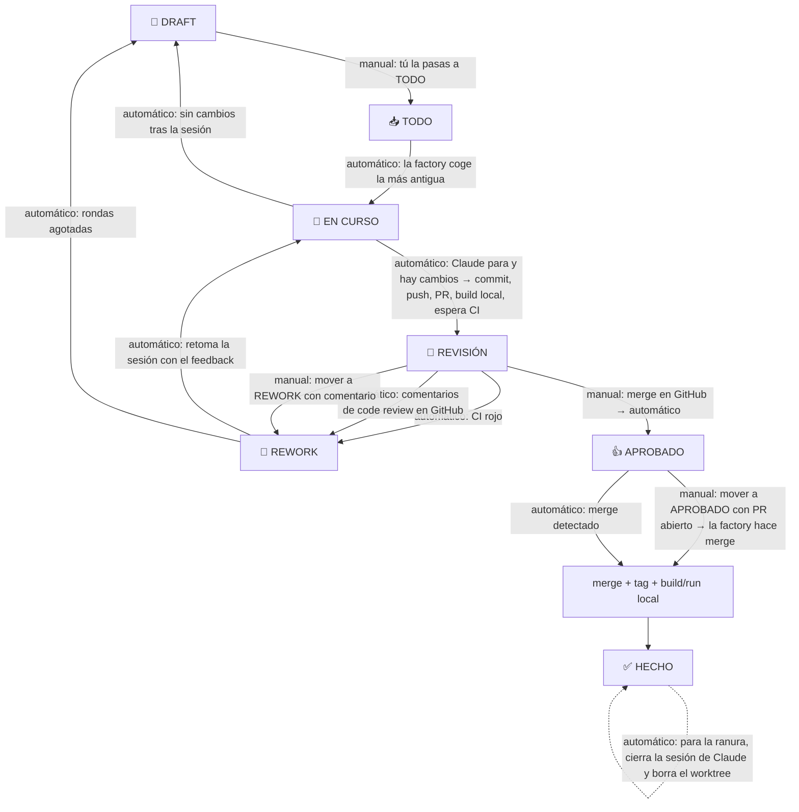

# Workflow de la factory

La columna de la tarea en Vikunja es su estado. La factory lee el tablero y actúa según la columna.

## Diagrama

## Automático y manual

| Paso | Quién | Qué pasa |
|---|---|---|
| Escribir la especificación en DRAFT | **Manual** | Título y descripción en Vikunja |
| DRAFT → TODO | **Manual** | Tú la pasas a 📥 TODO (o `factory ready ACA-n`) |
| TODO → EN CURSO | Automático | La factory coge la tarea más antigua en el siguiente ciclo (menos de 1 min, o al instante con el webhook) |
| Trabajo del agente | Automático, con tu intervención | Claude trabaja en una sesión con Remote Control. Tú contestas sus preguntas (grill me) desde la app |
| Publicar cambios (commit, push, PR) | Automático | Cuando Claude para y hay cambios en el repo |
| Build y despliegue local de la rama | Automático | En una ranura de test (R0–R4), con su URL |
| Espera al CI | Automático | Lee los runs de Forgejo para el commit del PR |
| CI en verde | Automático | La tarea pasa a 👀 REVISIÓN |
| CI en rojo | Automático | La tarea pasa a 🔁 REWORK con el log del fallo |
| Revisión del PR | **Manual** | Lo haces tú en GitHub |
| Comentarios de code review en GitHub | Automático | La tarea pasa a 🔁 REWORK con esos comentarios |
| Pedir cambios en Vikunja | **Manual** | Escribes el comentario y mueves la tarea a 🔁 REWORK |
| REWORK | Automático | Retoma la misma sesión de Claude con el feedback |
| Rondas de REWORK agotadas | Automático | La tarea vuelve a 📝 DRAFT y pide tu decisión (límite `max_rework`) |
| Merge del PR | **Manual** o automático | Haces merge en GitHub → APROBADO automático. O mueves la tarea a 👍 APROBADO con el PR abierto → la factory hace el merge |
| Tag y despliegue tras el merge | Automático | Crea `vX.Y.Z+1` y compila/arranca master en una ranura |
| APROBADO → HECHO | **Manual** | Lo pasas tú |
| Liberar la ranura al llegar a HECHO | Automático | Para la aplicación, cierra la sesión de Claude y borra el worktree. La conversación queda en disco |
| Desplegar a mano una rama | **Manual** | Tecla `d` en el TUI, o `factory deploy ACA-n` |
| Ver el estado | **Manual** | `factory start` (TUI), `factory list` |

## Dónde mirar

- **Estado y acciones**: el TUI (`factory start`). El detalle de cada tarea te dice qué hacer en cada estado.
- **Log**: `~/.local/state/factory/academia/factory.log`.
- **Ranuras**: `~/.local/state/factory/academia/slots/` (una carpeta por ranura).
- **Worktrees de tarea**: `~/.local/state/factory/academia/worktrees/`.
- **Conversaciones de Claude**: el ID está en el comentario «Sesión de Claude» de la tarea. Se retoman con `claude --resume <id>`.

## Límites conocidos

- Si Claude termina una sesión que se lanzó antes del hook `Stop`, la factory no recibe la señal. Hay que avisarla a mano: `date +%s > ~/.local/state/factory/academia/signals/<sesión>.stop`.
- El CI se lee de los runs de Forgejo. Si el run del commit nuevo tarda en aparecer, la factory espera.
- Las ranuras comparten base de datos y `data/`. Una migración de una rama afecta a todas.
